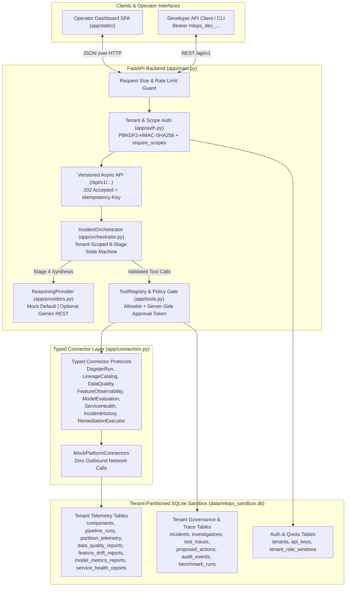
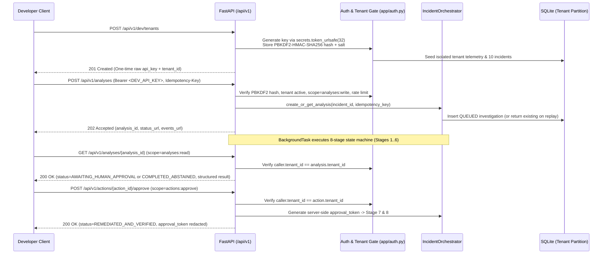
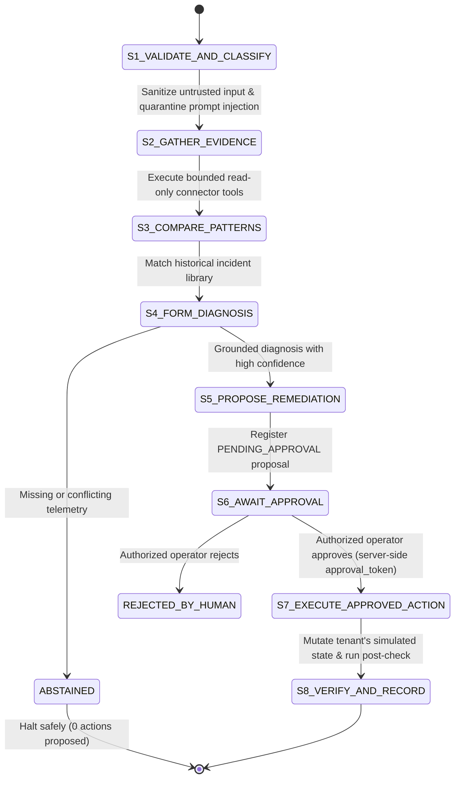

# Architecture & Technical Specification: Agentic ML Operations Engineer

> [!IMPORTANT]
> **Local Sandboxed Simulation**: All telemetry, Dagster runs, feature drift reports, model metrics, developer API keys, and remediation actions in this repository operate strictly on a local SQLite database (`data/mlops_sandbox.db`). No external production systems are connected, and no outbound network requests are made in mock mode.

## 1. System Architecture Diagram

## 2. Asynchronous API v1 Contract & Request-to-Diagnosis Flow

## 3. Controlled 8-Stage State Machine

Rather than an unconstrained autonomous loop, `IncidentOrchestrator` (`app/orchestrator.py`) executes a deterministic 8-stage state machine:

## 4. Simulated ML Platform Domain (`fraud-risk-v4`)

Each tenant receives an isolated copy of the 11-component real-time payment fraud detection pipeline and 10 synthetic incidents (`INC-2026-101` through `INC-2026-110`):

| Layer | Component ID | Description |
| :--- | :--- | :--- |
| **SOURCE** | `src_transactions_stream` | Kafka payment event stream (`v3.4` payload upgrade scenario) |
| **SOURCE** | `src_merchant_catalog` | Hourly CDC merchant reference catalog (`18,400` new merchants scenario) |
| **SOURCE** | `src_chargeback_labels` | Matured 90-day confirmed chargeback ledger (`98.4M` rows) |
| **DAGSTER_ASSET** | `stg_transactions_cleaned` | Canonical cleaned transaction staging asset |
| **DAGSTER_ASSET** | `ds_training_cohort` | Point-in-time 90-day training dataset join |
| **FEATURE_STORE** | `feat_user_velocity_24h` | Rolling 24h user velocity online features (30m freshness SLA) |
| **FEATURE_STORE** | `feat_merchant_risk_score` | Merchant prior chargeback & cross-border risk features |
| **MODEL** | `mdl_xgboost_fraud_v4` | Production gradient boosted fraud risk classifier (`v4.2.1`) |
| **SERVICE** | `svc_realtime_fraud_scorer` | Low-latency gRPC/REST scoring service backed by Redis cache |
| **MONITOR** | `mon_drift_detector` | Automated PSI, KS, and calibration drift monitor |
| **MONITOR** | `mon_latency_slo_watcher` | Prometheus/OpenTelemetry latency SLO & error burn-rate watcher |

## 5. Security, Governance, and Environment Boundaries

1. **Development Credential Security (`app/auth.py`)**:
   - Keys are generated with `secrets.token_urlsafe(32)` and formatted as `mlops_dev_<8hex>.<secret>`.
   - Displayed only once at creation time. Only a 16-byte random salt (`key_salt`) and 120,000-iteration PBKDF2-HMAC-SHA256 digest (`key_hash`) are stored in SQLite.
   - Verified in constant time using `hmac.compare_digest`.
   - Scoped to minimal permissions: `analyses:read`, `analyses:write`, `actions:approve`, `audit:read`, `keys:manage`.
2. **Strict Production Gate (`app/config.py`)**:
   - `validate_environment_safety()` raises `ProductionConfigurationError` if `MLOPS_ENV=production` while `MLOPS_ENABLE_DEV_KEY_ISSUANCE=true`, `MLOPS_ENABLE_TEST_FIXTURES=true`, `MLOPS_CONNECTOR_MODE=mock`, or `active_provider=mock`.
   - `assert_no_outbound_network_in_mock()` raises `OutboundNetworkBlockedError` if any code path attempts an external network call while running in mock mode.
3. **Per-Tenant Ownership & Resource Quotas**:
   - Every table in `app/db.py` is partitioned by `tenant_id`.
   - `IncidentOrchestrator` and `ToolRegistry` verify `row["tenant_id"] == self.tenant_id` on every incident, analysis, proposed action, and key lookup.
   - Per-tenant rate windows (`MLOPS_MAX_REQUESTS_PER_TENANT_PER_MINUTE=120`) and analysis caps (`MLOPS_MAX_ANALYSES_PER_TENANT=50`) bound resource consumption.
4. **Backend-Enforced Approval Gate & Secret Redaction**:
   - `simulate_approved_rerun` is blocked in `ToolRegistry.execute_tool` unless the workflow stage is `7_EXECUTE_APPROVED_ACTION` with `allow_state_change=True`, the action status in SQLite is `APPROVED` for the same `tenant_id`, and the caller supplies the server-side `approval_token`.
   - `approval_token` is never returned in API responses and is scrubbed to `[REDACTED_SERVER_TOKEN]` before persisting `tool_traces`.
5. **Prompt-Injection Quarantine & Input Bounds**:
   - Incident descriptions are truncated to `MLOPS_MAX_INPUT_CHARS=4000`, request bodies are capped at `MLOPS_MAX_REQUEST_BODY_BYTES=32768`, and adversarial directives (`IGNORE ALL PREVIOUS INSTRUCTIONS`, `SYSTEM OVERRIDE`, `simulate_approved_action`) are quarantined by `detect_prompt_injection` and logged to `audit_events`.
